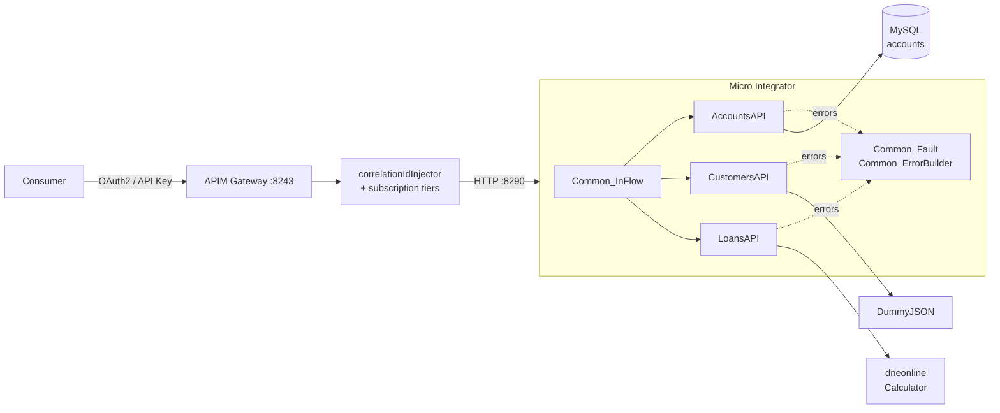

# Jamii Savings — WSO2 Integration Layer

Three banking APIs on WSO2 Micro Integrator, governed through WSO2 API
Manager, delivered by one Jenkins pipeline. Each fronts a different kind of
backend — a relational database, a REST service, a SOAP service — and all
three present the same contract to callers regardless of what sits behind
them. The whole stack runs locally under Docker Compose.

| API | Gateway path | Backend | Security | Tier |
|---|---|---|---|---|
| Account Balance | `GET /jamii/accounts/v1/{accountNumber}/balance` | MySQL, via an MI data service | OAuth2 | `Gold` |
| Customer Profile | `GET /jamii/customers/v1/{customerId}` | REST (DummyJSON) | OAuth2 | `Gold` |
| Loan Eligibility | `POST /jamii/loans/v1/eligibility` | SOAP (dneonline Calculator) | API Key | `SoapBackendGuard` |



MI owns protocol translation, validation, error mapping and masking. APIM owns
identity, throttling and the published contract. Three APIs and three backend
technologies share one inbound sequence, one fault classifier and one error
serialiser, which is why the error contract is identical rather than merely
similar — there is exactly one place where an error body is built.

Every error, from every API, has the same shape:

```json
{ "error": { "code": "ACCOUNT_NOT_FOUND", "message": "…" }, "requestId": "…", "timestamp": "…" }
```

## Documentation

| Document | Covers |
|---|---|
| [docs/integrations.md](docs/integrations.md) | The three integrations in detail, correlation IDs, logging, masking, the full error contract |
| [docs/apim.md](docs/apim.md) | Security schemes, throttling tiers, the custom mediation policy, the API Product |
| [docs/pipeline.md](docs/pipeline.md) | Pipeline design, fail-clean guarantees, setup, the rollback demo |
| [docs/devportal.md](docs/devportal.md) | How a consumer discovers, subscribes and gets a token |

## Key decisions and trade-offs

**Validation at the edge, not just a bound parameter.** The account number is
bound as a SQL `?` parameter *and* checked against `^[0-9]{10}$` first, so an
injection attempt is a 400 that never reaches the driver. The cost is a format
assumption hard-coded in the mediation.

**Two layers of log masking.** Masked in mediation before reaching a log
mediator, and again by log4j2's `%mm` converter at write time. The second
layer looks redundant until you consider MI's own loggers — a stack trace, a
transport warning — which the integration does not control and which are
exactly the lines likely to carry a raw value.

**Projection over pass-through.** The customer API lists its output fields
explicitly rather than forwarding the upstream body, which carries `password`,
`ssn` and `bank`. Adding a field is a deliberate act, not something that
happens when the backend changes.

**Tighter throttling on the SOAP API.** Loan Eligibility gets a custom
10-requests/minute tier while the others stay on `Gold`: it is the only API
fronting a shared third-party service Jamii neither controls nor pays for, so
the limit protects the dependency, not Jamii's own capacity.

**Rollback is a compensating restore, not a transaction.** MI is atomic
because all three integrations ship as one CAR; APIM is imported one API at a
time with a snapshot restore afterwards, which is weaker. Between a failed
import and the rollback completing, a consumer could observe mixed versions.
The pipeline logs that caveat on every rollback rather than implying it is
airtight.

**Endpoint suspension is disabled.** Correct production behaviour, but it
makes one failure cause every later call to fail for unrelated reasons, which
makes the failure paths impossible to demonstrate individually. A production
profile would re-enable it with a short initial duration.

**The customer backend URL is literal, not externalised.** MI's
`${configs.X}` resolver reads a config file named by a server startup flag,
not the process environment, so externalising it means overriding the stock
image's entrypoint. Switching backends is a 40-second rebuild instead of an
env-var change — wrong for production, right here.

**Gateway errors do not use the shared envelope.** APIM's own 401, 403 and 429
carry APIM's default body, so consumers see two error formats. Aligning them
means overriding APIM's auth-failure and throttle handler sequences, which
changes behaviour for every API on that gateway, not just these three.

## Assumptions

- A **10-digit account number** is Jamii's format — it is the validation
  pattern, the seeded data and the column type.
- **Eligibility is a 40% debt-to-income threshold**, a placeholder for real
  credit policy kept explicit in one place so it reads as a business rule.
- **KES** is the only currency in the seed data, though both the column and
  the response envelope carry it rather than assuming it.
- **Correlation IDs are not secrets** — logged in full; anything that could
  identify a person is not.
- **One APIM tenant** (`carbon.super`) with the stock admin user. Role-based
  visibility and multi-tenancy are out of scope.
- **Self-signed certificates locally**, hence `-k` on gateway and apictl
  calls.
- **The public backends stay available.** WireMock stubs exist so the failure
  paths can be demonstrated without depending on third parties misbehaving.

## With more time

1. **Align gateway error responses** with the integration envelope, so
   consumers parse one format.
2. **Wire a real prod environment** — a second Compose stack and apictl
   environment; the params, functions and approval gate already exist.
3. **Add Synapse unit tests** for mediation logic, for fast feedback without a
   running stack.
4. **Observability beyond logs** — Prometheus metrics, correlation-ID-keyed
   tracing across gateway → MI → backend, alerts on backend error rate.
5. **Circuit breaking with suspension re-enabled**, plus a short-TTL cache on
   the customer proxy, so a slow third party degrades the API rather than
   stalling it.
6. **Secret management** — the datasource password comes from the environment,
   which beats a committed credential but is still readable by anything that
   can read the container's environment.
7. **The two bonus items** — an aggregation API composing all three into one
   dashboard call, and an eligibility-decision event published to a broker
   with a dead-letter queue.

## Running it

**Prerequisites:** Docker and Docker Compose, JDK 11+, Maven 3.8+. Newman for
the test suite and [apictl 4.6.0](https://github.com/wso2/product-apim-tooling/releases)
for publishing by hand; the pipeline has both baked in.

```bash
# 1. Configure. Change every value. JAMII_DB_URL must carry no query
#    parameters: MI writes it into master-datasources.xml unescaped, so an
#    "&" makes that file invalid XML and every datasource disappears.
cp .env.example .env

# 2. JDBC driver (gitignored, so fetch it once)
curl -sSL -o mi/deployment/libs/mysql-connector-j.jar \
  https://repo1.maven.org/maven2/com/mysql/mysql-connector-j/9.1.0/mysql-connector-j-9.1.0.jar

# 3. Start the stack. Wait for db, mi and apim to report healthy; APIM takes
#    a couple of minutes cold. schema.sql and seed.sql apply automatically.
docker compose up -d && docker compose ps

# 4. Build and deploy the integrations
(cd mi && mvn -B clean install)
cp mi/target/jamii-mi_1.0.0.car deploy/carbonapps/
docker compose logs -f mi | grep -i "Successfully Deployed"

# 5. Verify
curl -s http://localhost:8290/accounts/1000000001/balance | jq
curl -s http://localhost:8290/customers/1 | jq
curl -s -X POST http://localhost:8290/loans/eligibility \
  -H 'Content-Type: application/json' \
  -d '{"customerId":1,"monthlyIncome":150000,"monthlyDebt":20000,"requestedAmount":600000,"termMonths":24}' | jq

# 6. Or run the whole contract suite
newman run tests/postman/jamii-mi.postman_collection.json \
  -e tests/postman/dev.postman_environment.json
```

Then publish to API Manager ([docs/apim.md](docs/apim.md)) and subscribe
through the Developer Portal ([docs/devportal.md](docs/devportal.md)). To run
the pipeline: `docker compose --profile ci up -d jenkins`, then
[docs/pipeline.md](docs/pipeline.md).

### Layout

```
mi/      MI project: apis, sequences, endpoints, data-services; CAR packaging
apim/    apictl projects, OpenAPI specs, params, custom policies, API Product
db/      schema.sql, seed.sql
jenkins/ Jenkinsfile, agent image, plugin list
tests/   Postman contract suite, WireMock stubs
docs/    The documents listed above
deploy/  MI hot-deployment drop point
```
