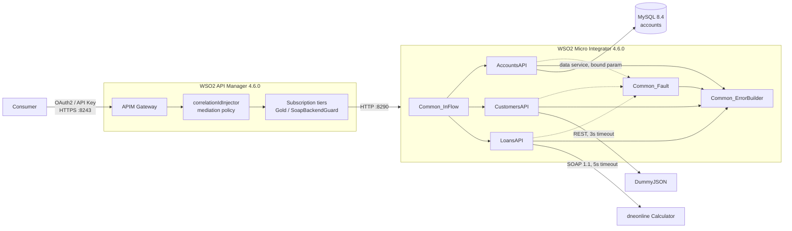

# Jamii Savings — WSO2 Integration Layer

Three production-shaped banking APIs built on WSO2 Micro Integrator, published
and governed through WSO2 API Manager, and delivered by a single Jenkins
pipeline. The whole stack — database, integration runtime, API gateway, mock
backends and CI — runs locally under Docker Compose.

Each API fronts a different *kind* of backend, which is the point of the
repository: one relational database, one REST service, one SOAP service. All
three present the same contract to callers regardless of what sits behind them.

| API | Method & path | Backend | Security |
|---|---|---|---|
| Account Balance | `GET /jamii/accounts/v1/{accountNumber}/balance` | MySQL, via an MI data service | OAuth2 |
| Customer Profile | `GET /jamii/customers/v1/{customerId}` | REST (DummyJSON) | OAuth2 |
| Loan Eligibility | `POST /jamii/loans/v1/eligibility` | SOAP (dneonline Calculator) | API Key |

---

## Contents

- [What it does](#what-it-does)
- [Architecture](#architecture)
- [The APIs](#the-apis)
- [Cross-cutting behaviour](#cross-cutting-behaviour)
- [The API Manager layer](#the-api-manager-layer)
- [The delivery pipeline](#the-delivery-pipeline)
- [Running it](#running-it)
- [Repository layout](#repository-layout)
- [Assumptions](#assumptions)
- [Trade-offs and known limitations](#trade-offs-and-known-limitations)
- [With more time](#with-more-time)

---

## What it does

### Account Balance

```bash
curl http://localhost:8290/accounts/1000000001/balance
```

```json
{
  "accountNumber": "1000000001",
  "status": "ACTIVE",
  "balance": { "amount": 125430.50, "currency": "KES" },
  "requestId": "9f1c2e4a-55d7-4f0a-9bb1-6a2b7c3d8e11",
  "timestamp": "2026-10-13T09:41:22.108+00:00"
}
```

`balance.amount` is a JSON number, not a string. `status` is one of `ACTIVE`,
`DORMANT`, `CLOSED`, read from the row rather than inferred.

### Customer Profile

```bash
curl http://localhost:8290/customers/1
```

```json
{
  "customerId": 1,
  "firstName": "Emily",
  "lastName": "Johnson",
  "email": "emily.johnson@x.dummyjson.com",
  "phone": "+81 965-431-3024",
  "city": "Phoenix",
  "requestId": "…",
  "timestamp": "…"
}
```

A projection, not a pass-through. The upstream record also carries
`password`, `ssn`, `bank` and `crypto` fields; none of them cross the
integration boundary.

### Loan Eligibility

```bash
curl -X POST http://localhost:8290/loans/eligibility \
  -H 'Content-Type: application/json' \
  -d '{"customerId":1,"monthlyIncome":150000,"monthlyDebt":20000,"requestedAmount":600000,"termMonths":24}'
```

```json
{
  "eligible": true,
  "monthlyInstalment": 25000,
  "debtToIncomeRatio": 0.3,
  "reason": "WITHIN_DTI_LIMIT",
  "requestId": "…",
  "timestamp": "…"
}
```

`eligible` is a JSON boolean. No SOAP envelope, namespace or XML fragment
appears in the response — not on success, and not on failure.

### Errors

Every error from every API, whatever the backend, has exactly this shape:

```json
{
  "error": { "code": "ACCOUNT_NOT_FOUND", "message": "No account matches the supplied account number" },
  "requestId": "9f1c2e4a-55d7-4f0a-9bb1-6a2b7c3d8e11",
  "timestamp": "2026-10-13T09:41:22.108+00:00"
}
```

| HTTP | `error.code` | Meaning |
|---|---|---|
| 400 | `INVALID_REQUEST` | Malformed path parameter, body or field value |
| 404 | `ACCOUNT_NOT_FOUND` | Well-formed account number, no such account |
| 404 | `CUSTOMER_NOT_FOUND` | No such customer upstream |
| 404 | `RESOURCE_NOT_FOUND` | No API resource matches the request |
| 422 | `ELIGIBILITY_CHECK_REJECTED` | The scoring service declined to assess |
| 502 | `BACKEND_ERROR` | Upstream answered, but unusably |
| 503 | `BACKEND_UNAVAILABLE` | Upstream unreachable |
| 503 | `DATA_SOURCE_UNAVAILABLE` | Database unreachable |
| 504 | `BACKEND_TIMEOUT` | Upstream too slow |
| 500 | `INTERNAL_ERROR` | Anything unclassified |

Backend hostnames, SQL, SOAP faults and stack traces are logged for operators
and never returned to a caller.

---

## Architecture



**Two layers, two jobs.** MI owns protocol translation, backend contracts,
validation, error mapping and masking. APIM owns identity, throttling,
discovery and the published contract. Neither does the other's job: MI has no
notion of who the caller is, and the gateway has no notion of what a
`DataServiceFault` means.

**Shared sequences, not copy-paste.** Three MI APIs, three backend
technologies, one inbound sequence (`Common_InFlow`), one fault classifier
(`Common_Fault`) and one error serialiser (`Common_ErrorBuilder`). That is
what makes the error contract identical across the three rather than merely
similar — there is exactly one place where an error body is built.

### Components

| Service | Image | Ports | Role |
|---|---|---|---|
| `db` | `mysql:8.4` | 3306 | `accounts` table; schema and seed applied on first boot |
| `mi` | `wso2/wso2mi:4.6.0` | 8290, 9201 | Integration runtime |
| `apim` | `wso2/wso2am:4.6.0` | 9443, 8243 | Publisher, Developer Portal, gateway |
| `wiremock` | `wiremock/wiremock:3.13.2-2` | 8080 | Deterministic stubs for timeout, outage and SOAP-fault paths |
| `jenkins` | built from `jenkins/` | 8081 | Pipeline; behind the `ci` profile |

---

## The APIs

### 1. Account Balance — database-backed

`AccountsAPI` → `AccountsDSEP` → `AccountsDS.dbs` → MySQL.

The row is read by a **data service** (`mi/src/main/wso2mi/artifacts/data-services/AccountsDS.dbs`),
not by hand-built SQL in the mediation flow:

```sql
SELECT account_number, status, balance_amount, currency FROM accounts WHERE account_number = ?
```

The account number is bound as an `IN` parameter by the driver. Nothing is
concatenated into the statement at any point. Independently of that, the
format is validated at the edge — `^[0-9]{10}$` — so a value shaped like SQL
is rejected with 400 before a database call is even attempted:

```bash
curl -i "http://localhost:8290/accounts/1'%20OR%20'1'='1/balance"   # 400 INVALID_REQUEST
curl -i http://localhost:8290/accounts/9999999999/balance            # 404 ACCOUNT_NOT_FOUND
docker compose stop db && curl -i http://localhost:8290/accounts/1000000001/balance
                                                                     # 503 DATA_SOURCE_UNAVAILABLE
```

Those last two are genuinely different code paths. "No such account" is
detected by the data service returning `<accounts/>` with no child row.
"Database is down" is detected by the presence of a `DataServiceFault`
element in the response. Neither is a 500.

The datasource (`JamiiDS`) is declared in `mi/deployment/deployment.toml` and
takes its URL, user and password from environment variables, so no credential
is committed. The data service is internal: it is called over localhost by
`AccountsAPI` and is never published through APIM.

### 2. Customer Profile — REST proxy

`CustomersAPI` → `CustomerBackendEP` → `https://dummyjson.com/users/{id}`.

**Backend choice.** DummyJSON was chosen over the better-known alternatives
(JSONPlaceholder, ReqRes) for three specific reasons:

1. Its user records carry realistic sensitive fields — `password`, `ssn`,
   `bank.cardNumber`, `crypto.wallet`, `email`, `phone`. That makes the
   difference between a projection and a pass-through demonstrable rather
   than theoretical.
2. It returns a proper `404` for unknown ids, so the not-found path is the
   backend's real behaviour rather than something simulated.
3. No authentication, no signup, no rate limit that interferes with a demo.

Header manipulation runs in both directions:

- **Outbound** — `Authorization`, `X-JWT-Assertion`, `Cookie` and
  `X-Internal-Debug` are stripped before the request leaves MI. Gateway
  credentials are for the gateway; they have no business reaching a third
  party. `Accept-Encoding` is also dropped, because forwarding a caller's
  `gzip, deflate, br` makes the backend return a compressed body that the
  passthrough transport cannot parse.
- **Inbound** — every upstream header is discarded (`TRANSPORT_HEADERS`
  removed), then only `X-Correlation-ID` and the content type are re-added.
  No `Server`, `X-Powered-By`, `Set-Cookie`, CORS or upstream rate-limit
  header reaches a client.

Timeout is explicit and distinct from unavailability:

```xml
<timeout><duration>3000</duration><responseAction>fault</responseAction></timeout>
```

A slow backend is `504 BACKEND_TIMEOUT` in under four seconds; an unreachable
one is `503 BACKEND_UNAVAILABLE`. The WireMock stubs in `tests/wiremock/mappings/`
reproduce the slow and not-found cases on demand, without depending on the
real backend misbehaving.

### 3. Loan Eligibility — SOAP to REST

`LoansAPI` → `CalculatorSoapEP` → `http://www.dneonline.com/calculator.asmx`.

**Service choice and mapping.** The dneonline Calculator is a long-lived
public SOAP 1.1 service with a published WSDL, no auth, and — importantly —
deterministic arithmetic, so a test asserting an exact number stays valid.
There is no public SOAP *credit-scoring* service to call; what matters here is
that the integration genuinely performs SOAP-to-REST translation, so the
Calculator stands in for the scoring service and its `Divide` operation
carries the one piece of arithmetic the decision needs:

| Loan concept | SOAP call | Result |
|---|---|---|
| `requestedAmount` | `intA` | |
| `termMonths` | `intB` | |
| monthly instalment | `Divide(intA, intB)` → `DivideResult` | `monthlyInstalment` |

MI then applies the lending rule locally:

```
debtToIncomeRatio = (monthlyInstalment + monthlyDebt) / monthlyIncome
eligible          = debtToIncomeRatio <= 0.40
```

So the remote service computes, the integration decides, and the caller sees a
banking answer (`eligible`, `reason`) rather than an arithmetic one. Swapping
in a real scoring service means changing one endpoint and one payload
transformation; the API contract does not move.

Three details matter in the implementation:

- The endpoint is declared `format="soap11"`, so the mediation builds only the
  `<tem:Divide>` operation element and MI wraps the envelope. Building a full
  envelope *and* setting the format nests one inside the other.
- `requestedAmount` and `termMonths` are coerced to integers with XPath 1.0
  string functions before the call, because `intA`/`intB` are integer-typed
  and `round()` alone can render as `600000.0`.
- Fault detection precedes result parsing. A Fault envelope has no
  `DivideResult`, so parsing first would misreport a fault as a malformed
  response.

A SOAP Fault becomes `422 ELIGIBILITY_CHECK_REJECTED`. The `faultcode` and
`faultstring` are logged at WARN and never returned; the response body
contains no `<` character at all.

Validation rejects zero or negative `monthlyIncome`, `requestedAmount` and
`termMonths` with 400 before the call — which is also what stops the service
ever being asked to divide by zero. To exercise the fault path deliberately,
point `CalculatorSoapEP` at the WireMock stub
(`tests/wiremock/mappings/soap-fault.json`) and rebuild.

---

## Cross-cutting behaviour

### Correlation IDs

One identifier ties the gateway, the integration and the backend call
together. It is also the `requestId` in every response body and the
`X-Correlation-ID` response header.

```bash
curl -s -H 'X-Correlation-ID: demo-req-001' http://localhost:8290/customers/1 | jq -r .requestId
# demo-req-001
```

A caller-supplied value is reused only if it matches `^[A-Za-z0-9-]{8,64}$`;
anything else is replaced with a generated UUID. That is deliberate — an
unvalidated client header ends up in log files, and log files get read by
tools that interpret what they find. The same check exists at the gateway in
the `correlationIdInjector` policy, so the ID is present even for traffic that
reaches MI through APIM.

### Logging

Each API emits three structured log events sharing one `requestId`:

```
event = REQUEST_IN,  requestId = …, api = CustomersAPI, method = GET
event = BACKEND_CALL, requestId = …, backend = CustomerBackend, customerId = 1
event = RESPONSE_OUT, requestId = …, status = 200, customerId = 1
```

### Masking

Two independent layers:

1. **In mediation.** The sensitive value is masked *before* it is ever passed
   to a log mediator. The account number is logged as `******0001`, computed
   in the flow. Customer name, email and phone are simply never logged. The
   request path is not logged either, because it carries the identifier.
2. **In log4j2.** `mi/deployment/deployment.toml` renders masking patterns for
   `ACCOUNT_NUMBER`, `EMAIL` and `PHONE`, and `mi/deployment/log4j2.properties`
   uses the `%mm` masking converter on every message-carrying appender.

The second layer exists because the first only covers the log lines this
repository writes. MI's own loggers — a stack trace on a failure path, a
transport-level warning — are not under the integration's control, and those
are exactly the lines likely to carry a raw value. Mediation-level masking
alone leaves that gap; `%mm` closes it.

### Malformed input is 400, never 500

| Request | Result |
|---|---|
| `GET /accounts/abc/balance` | 400 `INVALID_REQUEST` |
| `GET /customers/abc` | 400 `INVALID_REQUEST` |
| `POST /loans/eligibility` with `{"bad":` | 400 `INVALID_REQUEST` |
| `POST /loans/eligibility` missing `termMonths` | 400 `INVALID_REQUEST` |
| `GET /accounts/1000000001/nonsense` | 404 `RESOURCE_NOT_FOUND` |

Path and body parameters are validated against explicit patterns in each API
before any backend call. A body that is not JSON at all fails earlier, during
message building, and `Common_Fault` classifies it: only JSON-parse-specific
wording counts as a client error, so an unreadable *backend* response is
reported as `502`, not as "your request was malformed".

---

## The API Manager layer

All three APIs are published and callable through the gateway at
`https://localhost:8243`. Definitions live in `apim/apis/<api>/` as apictl
projects — `api.yaml` plus an OpenAPI 3.0.3 document under `Definitions/` —
so the published contract is version-controlled rather than clicked into a UI.

### Security schemes

| API | Scheme | Why |
|---|---|---|
| Account Balance | OAuth2 (client credentials) | Internal channel consumer: mobile and internet banking, acting as itself |
| Customer Profile | OAuth2 (client credentials) | Same consumer pattern |
| Loan Eligibility | API Key | Expected consumer is a partner broker integration; a long-lived key is the lower-friction fit, and it demonstrates a second scheme in the same deployment |

### Throttling

| API | Tier | Limit |
|---|---|---|
| Account Balance | `Gold` | Stock tier |
| Customer Profile | `Gold` | Stock tier |
| Loan Eligibility | **`SoapBackendGuard`** | **10 requests/minute** |

**Why one tier is different, in one line:** Loan Eligibility is the only API
fronting a shared public SOAP service that Jamii neither controls nor pays
for, so the gateway throttles consumers hard enough to protect that dependency
rather than sizing the limit to Jamii's own capacity.

The tier is defined in `apim/policies/rate-limiting/Subscription-SoapBackendGuard.yaml`
and must exist in APIM *before* the loans API is imported — an API referencing
an absent tier fails with `900305 The tier name is invalid`.

### Custom mediation policy

`apim/policies/correlationIdInjector/` — a request-flow Synapse policy
attached to the balance API's operation. It guarantees `X-Correlation-ID` is
set at the gateway edge, validating a caller-supplied value against
`^[A-Za-z0-9-]{8,64}$` and substituting a generated one otherwise.

This belongs at the gateway rather than only in MI because the gateway is the
first hop that sees the request. A request rejected by throttling or auth
never reaches MI, and without this policy such a rejection has no identifier
to correlate against the consumer's own logs.

The policy is attached declaratively in `api.yaml` so the pipeline reapplies
it on every import, rather than depending on a Publisher UI action that
nothing version-controls.

### API Product

`JamiiCoreBanking` v1 (`/jamii/core`) bundles all three APIs.

Included rather than justified away, because the consumer shapes genuinely
differ: a banking channel app needs balance, profile *and* eligibility, and
should get one subscription and one set of credentials for the set. A partner
broker needs eligibility alone. Both are served — the product exists, and the
three APIs remain individually subscribable.

Subscription walkthrough, including token acquisition and both auth schemes:
**[docs/devportal.md](docs/devportal.md)**.

---

## The delivery pipeline

One `jenkins/Jenkinsfile` covers all three APIs. The APIs are declared once:

```groovy
def APIS = ['account-balance', 'customer-profile', 'loan-eligibility']
```

and every later stage iterates that list. Adding a fourth API means adding one
entry — there are no per-API stage blocks to duplicate.

| Stage | Does | Touches the target? |
|---|---|---|
| Validate | XML well-formedness of all MI artifacts; presence of each APIM project | No |
| Build MI | `mvn -B clean install` → `jamii-mi_1.0.0.car`, archived | No |
| Package APIM | Each apictl project packaged and archived | No |
| Test | Newman contract suite, 33 assertions, JUnit-reported | No |
| Snapshot | Current CAR + live export of all three APIs | No |
| Dev: deploy MI | CAR into the watched directory, then poll the live API until it answers | **Yes** |
| Dev: publish APIM | Tier → three APIs → API Product, via apictl | **Yes** |
| Dev: smoke tests | Same suite again, against what was just deployed | No |
| Approve prod | Manual `input`, gated on `DEPLOY_PROD` | — |
| Prod: deploy & publish | Same functions, prod params | Gated |

**Ordering is the first safety mechanism.** Everything that can fail without
side effects runs before anything that can change the target, so a broken
artifact, a failing build or a failing test ends the run with the environment
untouched.

**It fails clean.** Deployment is not a transaction, so the pipeline is built
to leave no half-updated state:

- All three integrations ship as **one CAR**. MI reverts the entire composite
  application if any artifact in it is bad, so the runtime is either fully on
  the new version or fully on the old one.
- APIM imports are **sequential and fail-fast**, in dependency order.
- A **snapshot** is taken immediately before deploying, and `post { failure }`
  restores both MI and all three APIs from it.
- Rollback is armed *before* the imports begin, not after they succeed —
  otherwise a failure on the third import would skip the rollback in exactly
  the case that needs it.
- An already-existing tier or product is tolerated **only** on HTTP 409.
  Every other error fails the stage. A blanket `|| true` there would be the
  silent partial deploy this design exists to prevent.

Reproduce it with the `BREAK_API` parameter:

```
Dev: deploy MI                → MI is serving the new CAR
Dev: publish APIM
  account-balance             → Successfully imported API.
  customer-profile            → Successfully imported API.
  loan-eligibility            → 900305 The tier name is invalid.
ROLLBACK: undoing [mi:dev, apim:dev]
ROLLBACK: restored the previously deployed MI composite application
ROLLBACK: restored account-balance / customer-profile / loan-eligibility
Finished: FAILURE
```

**Environments.** `apim/params/*-params.yaml` carry a `dev` and a `prod`
block, and `publishApim(envName, apis)` is environment-parameterised, so
promotion changes parameters rather than API definitions. Prod is gated behind
an approval and is not wired to a real stack in this repository.

Setup, credentials and the failure demo: **[docs/jenkins-setup.md](docs/jenkins-setup.md)**.

---

## Running it

### Prerequisites

Docker and Docker Compose, JDK 11+, Maven 3.8+, and the MySQL
Connector/J jar. [apictl 4.6.0](https://github.com/wso2/product-apim-tooling/releases)
is needed only to publish to APIM by hand; the pipeline has it baked in.

### 1. Configure

```bash
cp .env.example .env
```

Edit `.env` and change every value. `.env` is gitignored; only the template is
committed. One constraint: `JAMII_DB_URL` must carry **no query parameters**.
MI's config mapper writes it into `master-datasources.xml` unescaped, so an
`&` makes that file invalid XML and every datasource silently disappears.

### 2. Add the JDBC driver

```bash
curl -L -o mi/deployment/libs/mysql-connector-j.jar \
  https://repo1.maven.org/maven2/com/mysql/mysql-connector-j/9.1.0/mysql-connector-j-9.1.0.jar
```

### 3. Start the stack

```bash
docker compose up -d
docker compose ps
```

Wait for `db`, `mi` and `apim` to report healthy — APIM takes a couple of
minutes on a cold start. `db/schema.sql` and `db/seed.sql` are applied
automatically on the database's first boot.

### 4. Build and deploy the integrations

```bash
cd mi && mvn -B clean install && cd ..
cp mi/target/jamii-mi_1.0.0.car deploy/carbonapps/
```

`deploy/carbonapps/` is bind-mounted into MI's hot-deployment directory, so
the composite application deploys within a few seconds. Watch it land:

```bash
docker compose logs -f mi | grep -i "Successfully Deployed"
```

### 5. Verify

```bash
curl -s http://localhost:8290/accounts/1000000001/balance | jq
curl -s http://localhost:8290/customers/1 | jq
curl -s -X POST http://localhost:8290/loans/eligibility \
  -H 'Content-Type: application/json' \
  -d '{"customerId":1,"monthlyIncome":150000,"monthlyDebt":20000,"requestedAmount":600000,"termMonths":24}' | jq
```

Or run the whole contract suite:

```bash
newman run tests/postman/jamii-mi.postman_collection.json \
  -e tests/postman/dev.postman_environment.json
```

### 6. Publish to API Manager

```bash
apictl add env dev --apim https://localhost:9443
apictl login dev -u admin -k

apictl import policy rate-limiting -f apim/policies/rate-limiting/Subscription-SoapBackendGuard.yaml -e dev -k
for api in account-balance customer-profile loan-eligibility; do
  apictl import api -f "apim/apis/$api" -e dev --params "apim/params/$api-params.yaml" --update --rotate-revision -k
done
apictl import api-product -f apim/products/JamiiCoreBanking-v1 -e dev --update-api-product -k
```

The tier must be imported first; the product last. Then subscribe and call the
gateway following **[docs/devportal.md](docs/devportal.md)**.

### 7. Run the pipeline (optional)

```bash
docker compose --profile ci up -d jenkins
```

Jenkins is on `http://localhost:8081`. See
**[docs/jenkins-setup.md](docs/jenkins-setup.md)**.

### Demonstrating the failure paths

| Path | How |
|---|---|
| `503 DATA_SOURCE_UNAVAILABLE` | `docker compose stop db`, then call the balance API |
| `504 BACKEND_TIMEOUT` | Point `CustomerBackendEP` at `http://wiremock:8080/users/{uri.var.customerId}` (5 s delay stub) and rebuild |
| `503 BACKEND_UNAVAILABLE` | Point `CustomerBackendEP` at a closed port and rebuild |
| `422 ELIGIBILITY_CHECK_REJECTED` | Point `CalculatorSoapEP` at `http://wiremock:8080/calculator.asmx` and rebuild |
| Pipeline rollback | Run the job with `BREAK_API = loan-eligibility` |

---

## Repository layout

```
├── mi/                                   WSO2 Micro Integrator project
│   ├── pom.xml                           CAR packaging (vscode-car-plugin)
│   ├── deployment/
│   │   ├── deployment.toml               Datasource + log masking patterns
│   │   ├── log4j2.properties             %mm masking converter
│   │   └── libs/                         JDBC driver (not committed)
│   └── src/main/wso2mi/artifacts/
│       ├── apis/                         AccountsAPI, CustomersAPI, LoansAPI
│       ├── sequences/                    Common_InFlow, _Fault, _ErrorBuilder
│       ├── endpoints/                    One per backend, with timeouts
│       └── data-services/AccountsDS.dbs  Parameterised SQL query
├── apim/
│   ├── apis/<api>/                       apictl projects + OpenAPI 3.0.3
│   ├── params/                           Per-environment endpoints (dev, prod)
│   ├── policies/                         Custom tier + mediation policy
│   └── products/JamiiCoreBanking-v1/     API Product
├── db/                                   schema.sql, seed.sql
├── jenkins/                              Jenkinsfile, agent image, plugins
├── tests/
│   ├── postman/                          Contract suite (33 assertions)
│   └── wiremock/mappings/                Timeout, not-found, SOAP-fault stubs
├── docs/                                 Dev Portal + pipeline guides
├── deploy/carbonapps/                    MI hot-deployment drop point
├── docker-compose.yml
└── .env.example
```

---

## Assumptions

- **A 10-digit account number** is Jamii's format. It is the validation
  pattern, the seeded data shape and the column type (`CHAR(10)`).
- **`accountNumber` is the API's identifier, not a database key to expose.**
  Nothing in the response reveals row ids or customer ids from the accounts
  table.
- **Eligibility is a 40% debt-to-income threshold.** A placeholder for a real
  credit policy, kept explicit in one place so it is obviously a business rule
  rather than something buried in a transformation.
- **KES** is the only currency in the seed data, though the column and the
  response envelope both carry it rather than assuming it.
- **Correlation IDs are not secrets.** They are logged in full; identifiers
  that could identify a person are not.
- **One APIM tenant, `carbon.super`**, with the stock `admin` user. Role-based
  visibility and multi-tenancy are out of scope.
- **Self-signed certificates locally**, hence `-k` on every apictl and gateway
  call. A real deployment terminates TLS with a real certificate.
- **The public backends stay available.** DummyJSON and dneonline are third
  parties; the WireMock stubs exist so the failure paths can be demonstrated
  without depending on them.

---

## Trade-offs and known limitations

**The customer backend URL is literal, not externalised.** It sits in
`CustomerBackendEP.xml` rather than coming from the environment. MI's
`${configs.X}` resolver reads a config file named by a server startup flag,
not the process environment, so externalising it means overriding the stock
image's entrypoint. Switching backends for a demo is a rebuild (about 40
seconds) instead of an env-var change. A real deployment would pass that flag
in its own image; here the cost of a custom entrypoint outweighed the
convenience.

**Endpoint suspension is disabled.** All three endpoints set
`suspendOnFailure` to zero duration. Suspension is the right production
behaviour — it stops hammering a dead backend — but it also means that after a
single failure every subsequent call fails for reasons unrelated to itself,
which makes the failure paths impossible to demonstrate one at a time. A
production profile would re-enable it with a short initial duration.

**Rollback is a compensating restore, not a distributed transaction.** MI is
atomic because all three integrations ship as one CAR. APIM is sequential with
a restore afterwards, which is weaker: between a failed import and the
rollback completing, a consumer could observe a mix of versions. The pipeline
logs that caveat on every rollback rather than implying it is airtight.
Closing the gap properly needs per-environment pinned API revisions or
blue/green gateways.

**Gateway-generated errors do not use the shared envelope.** A 401, 403 or 429
comes from APIM's own handlers and carries APIM's default body, so a consumer
sees two error formats: the integration's for 4xx/5xx from the backend, and
APIM's for authentication and throttling. Aligning them means overriding
APIM's `_auth_failure_handler_` and throttle handler sequences at the gateway —
a worthwhile change, but one that modifies product behaviour for every API on
the gateway, not just these three.

**Prod is wired conceptually, not actually.** The params, the functions and the
approval gate are real; the target is not. Making it real is a second compose
stack and a second apictl environment, with no change to pipeline logic.

**Synapse unit tests are not wired.** The `with-tests` Maven profile and the
`synapse-unit-test-maven-plugin` configuration are present, but the test suite
is the Newman contract collection in `tests/postman/` — nine requests, 33
assertions, run twice per pipeline. Those exercise the real runtime against
real backends, including the error envelope, JSON types, correlation reuse and
the absence of upstream secrets, which is where the risk actually is. Synapse
unit tests would add fast feedback on mediation logic without a running stack.

**The data service is minimal by design.** One query, one resource, no caching
and no connection-pool tuning beyond the defaults. It demonstrates
parameterised access, not a production data layer.

---

## With more time

1. **Align gateway error responses** with the integration envelope by
   overriding APIM's auth-failure and throttle handler sequences, so consumers
   parse one error format.
2. **Wire a real prod environment** — a second compose stack, a second apictl
   environment, and the commented-out `deployMi('prod')` call enabled.
3. **Add Synapse unit tests** for the mediation logic, so a transformation
   regression is caught in seconds without a running stack.
4. **Observability beyond logs** — Prometheus metrics from MI and APIM,
   correlation-ID-keyed tracing across gateway → MI → backend, and alerts on
   backend error rate rather than on log greps.
5. **Circuit breaking with suspension re-enabled**, plus a short-TTL cache on
   the customer proxy, so a slow third party degrades the API rather than
   stalling it.
6. **Secret management** — the datasource password comes from the environment
   today, which is better than a committed credential but still visible to
   anything that can read the container's environment. A real deployment reads
   it from a vault at boot.
7. **The two bonus items** — an aggregation API composing all three
   integrations into a single customer dashboard call, and an event published
   to a message broker on each eligibility decision with a dead-letter queue
   for failed consumers.
